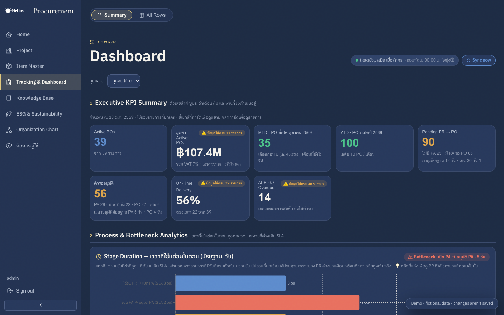
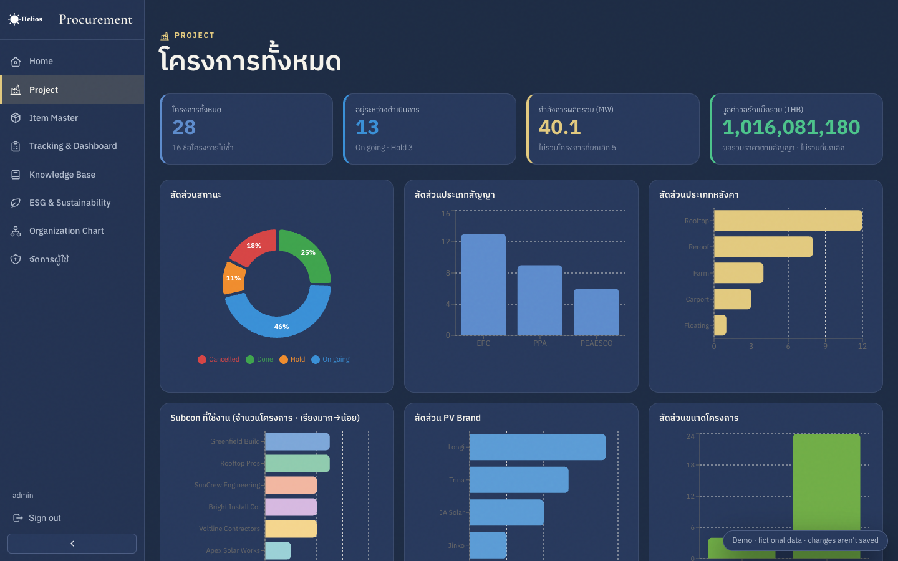
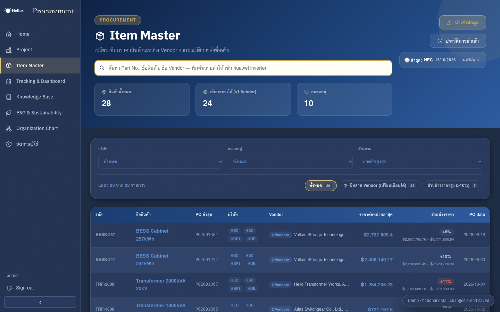

# Procurement Dashboard

An internal-style web app for a central procurement department: read-mostly dashboards plus a few data-entry flows.
Built as a portfolio project — all company names, people and figures in this repo are fictional placeholders.



| Projects | Item Master |
|---|---|
|  |  |

## Live demo

The demo runs entirely in the browser: the Firebase SDK is swapped for an in-memory mock (`src/demo/`) seeded with generated, fictional data, and you are signed in automatically. Edits work but reset on reload.

```bash
npm run dev:demo      # local demo, no Firebase needed
npm run build:demo    # static build → dist/
```

Deploy: import the repo in Vercel (`vercel.json` is included), or publish to GitHub Pages by copying `docs/github-pages-workflow.yml` to `.github/workflows/deploy-demo.yml` and setting Settings → Pages → Source: GitHub Actions.

## Features

- **PR / PA / PO tracking** — stage KPIs, aging, SLA bottleneck detection, drill-down, slide-over detail drawer, Excel export
- **Executive dashboard** — KPI cards, stage-duration analysis, top overdue, monthly trend, alerts, data-integrity checks
- **Item Master** — cross-vendor price comparison, price variance, price-trend chart, Excel import (header-name mapping)
- **Project register** — KPI cards, grouped project table with expand/collapse, charts, portfolio cards with progress
- **Vendor directory, Knowledge base, ESG, Org chart**
- **Cost-aware data layer** — 12-hour batch sync into an IndexedDB cache and a rate-limited "Sync now" to stay inside Firestore's free quota
- **Closed-system access control** — email allowlist enforced by Firestore Security Rules (`firestore.rules`)
- **Google Sheets → Firestore sync** via Apps Script (`google-apps-script/`)

## Tech stack

React 19 · TypeScript · Vite · Firebase (Auth, Firestore) · Recharts · SheetJS (xlsx) · Tabler Icons — plain CSS tokens, no CSS framework.

## Getting started with a real backend

```bash
npm install
cp .env.example .env.local   # fill in your own Firebase web config
npm run dev
```

Replace `admin@example.com` in `src/config/admins.ts` and `firestore.rules` with your own admin email, then publish the rules in the Firebase console.
See `docs/TECHNICAL.md` and `docs/SECURITY.md` for architecture and access-control details.

## Scripts

`npm run dev` · `npm run build` · `npm run lint`
